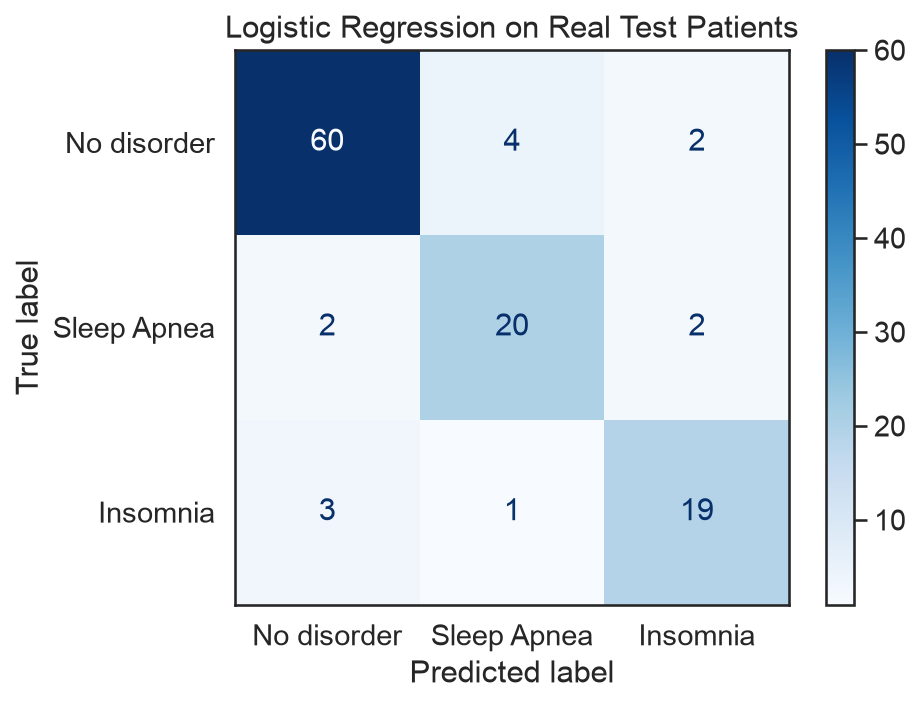
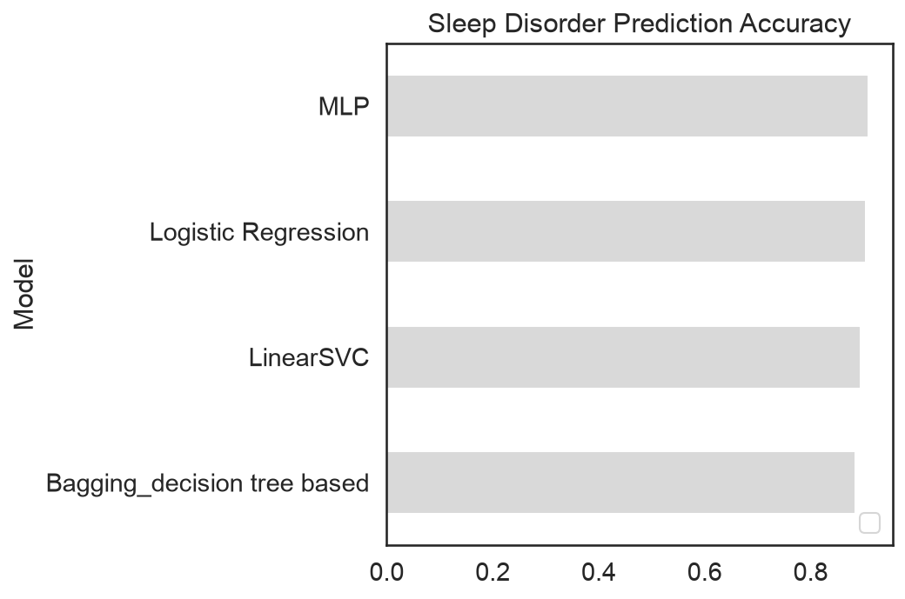
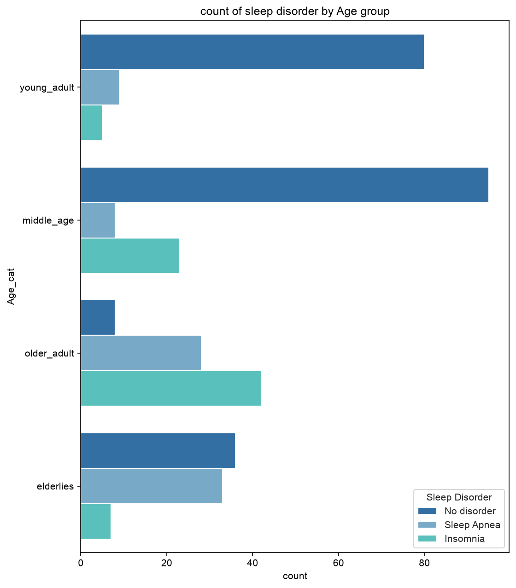
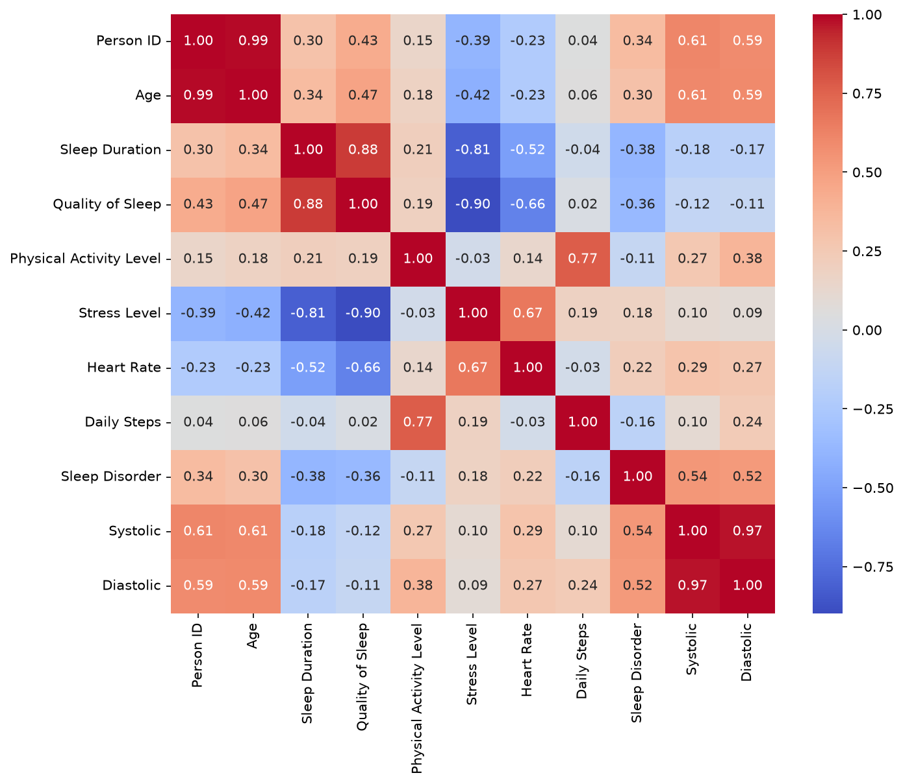

# 😴 Sleep Disorder Prediction with Multi-Class Machine Learning

## 📌 Project Overview

This project uses Python and machine learning to predict whether a patient has **insomnia**, **sleep apnea**, or **no sleep disorder**. The dataset covers 374 people with gender, age, occupation, sleep duration, sleep quality, physical activity, stress level, BMI category, blood pressure, heart rate, and daily steps. About **59% had no sleep disorder**, 21% had sleep apnea, and 21% had insomnia.

Each patient has one condition, so this is a **multi-class** problem. I explored the data, tested which factors relate to sleep quality, balanced the classes with SMOTE, and trained four models: Logistic Regression, Linear SVC, Bagging Decision Trees, and an MLP neural network.

The first models scored **88% to 91% accuracy**. I then audited how they were tested. **Of the 198 test rows, 161 were exact copies of a training row**, because the data repeats patient profiles and the classes were balanced before the train/test split. With the overlap removed, accuracy fell to **86.9%**, and a decision tree that asks only **two questions** scored **87.4%**, matching every model. A clinical check also showed the sleep apnea patterns do not match real patients, which suggests the data is synthetic.

## 🎯 Key Features

✅ Data Cleaning: Filled missing sleep disorder labels, split blood pressure into systolic and diastolic, and merged duplicate BMI labels. 
✅ Feature Engineering: Created four age categories from percentiles. 
✅ Exploratory Analysis: Compared sleep duration, sleep quality, and sleep disorder rates across occupation, age, BMI, and activity level. 
✅ Statistical Testing: Used a t-test, ANOVA, and chi-square tests to check relationships with sleep quality and sleep disorders. 
✅ Class Balancing: Used SMOTE to balance the three classes. 
✅ Model Comparison: Trained Logistic Regression, Linear SVC, Bagging Decision Trees, and an MLP Classifier. 
✅ Data Leakage Audit: Found that 161 of 198 test rows were copies of training rows. 
✅ Honest Evaluation: Applied SMOTE to training data only and reported recall for each sleep disorder. 
✅ Grouped Cross-Validation: Kept identical patient profiles out of both training and test folds at the same time. 
✅ Simple Baseline: Compared the models with a two-question decision tree. 
✅ Feature Removal Test: Retrained without occupation and gender, and with BMI and blood pressure only. 
✅ Clinical Plausibility Check: Compared sleep apnea patterns with known clinical risk factors.

## 📷 Visualizations

### Confusion Matrix (Real Test Patients)

### Model Accuracy (Before the Leakage Audit)

### Sleep Disorders by Age Group

### Correlation Matrix

## 🗂️ Repository Files

| File | Description |
|------|-------------|
| `sleep_data.csv` | Raw dataset: 374 rows and 13 columns of sleep, health, and lifestyle data |
| `sleep_disorder_prediction.ipynb` | Jupyter Notebook with the full code, models, and outputs |
| `confusion_matrix.png` | Logistic regression results on real test patients |
| `model_accuracy.png` | Accuracy of the four models on the original test set |
| `sleep_disorder_by_age.png` | Sleep disorder counts by age group |
| `correlation_heatmap.png` | Correlation matrix of numeric features |

## 🧹 Data Preparation

- Loaded the data with `pd.read_csv()` using a relative file path, so the notebook runs from any computer.
- Filled 219 blank `Sleep Disorder` values with "No disorder." A blank meant the person had no diagnosed sleep disorder, not missing data.
- Split `Blood Pressure` (such as "130/85") into numeric `Systolic` and `Diastolic` columns.
- Merged the "Normal Weight" BMI label into "Normal," leaving three categories: Normal, Overweight, and Obese.
- Grouped age into four categories using the 25th, 50th, and 75th percentiles.
- Dropped `Person ID`, `Age`, and the text `Blood Pressure` column before modeling.
- Standardized 8 numeric features and one-hot encoded the categorical columns, for 28 model features.
- **Found 242 duplicate rows** once `Person ID` was removed, leaving only **132 unique patient profiles**.
- Fixed `random_state=42` on the Bagging and MLP models so the results stay the same on every run.

## 🛠️ Skills & Tools Applied

- Language and Environment: Python, Jupyter Notebook (Anaconda)
- Libraries: pandas, NumPy, Matplotlib, Seaborn, SciPy, pingouin, scikit-learn, imbalanced-learn
- Models: Logistic Regression, Linear SVC, Bagging Decision Trees, MLP Classifier, Decision Tree (baseline)
- Statistics: Independent t-test, one-way ANOVA, chi-square tests
- Evaluation: Accuracy, precision, recall, F1-score, confusion matrix, per-class recall
- Validation: Leakage audit, pipeline-based SMOTE, standard and grouped 5-fold cross-validation
- Clinical Knowledge: Sleep apnea risk factors, clinical plausibility review

## 📈 Business Questions Answered

This project provides insights into:

- Which lifestyle and health factors are linked to sleep quality and sleep disorders?
- Can routine health data identify patients with insomnia or sleep apnea?
- Do the reported accuracy scores hold up on patients the model has not seen?
- Does a complex model beat a simple two-question rule?
- Does the model rely on clinical measures or on occupation?
- Does the data match what is known about sleep disorders?

## 💡 Key Insights

### Sleep Patterns

- **Physical activity was linked to better sleep.** People with an activity level of 60 or higher averaged a sleep quality of **7.7**, compared with **6.8** for less active people (t-test, p < 0.001).
- **Sleep quality differed by sleep disorder** (ANOVA, F = 27.6, p < 0.001). Average quality was 7.6 with no disorder, 7.2 with sleep apnea, and **6.5 with insomnia**.
- **BMI category was the clearest divider.** 92.6% of people with a normal BMI had no sleep disorder. Among overweight people, 87.2% had insomnia or sleep apnea.
- Sales representatives and scientists slept the least (about 6 hours), and engineers slept the most (8.0 hours).

These results show associations, not causes.

### Model Results on the Original Test Set

| Model | Accuracy | Precision | Recall | F1 |
|---|---|---|---|---|
| Logistic Regression | 90.4% | 91.9% | 91.9% | 91.9% |
| Linear SVC | 89.4% | 91.9% | 91.4% | 91.6% |
| Bagging Decision Trees | 88.4% | 91.6% | 88.4% | 90.0% |
| **MLP Classifier** | **90.9%** | **92.0%** | **92.9%** | **92.5%** |

### Data Leakage Audit

| Check | Result |
|---|---|
| Duplicate rows (ignoring Person ID) | **242 of 374** |
| Unique patient profiles | 132 |
| Test rows created by SMOTE | 80 of 198 |
| Test rows identical to a training row | **161 of 198** |

- SMOTE ran before the train/test split, so synthetic patients built from training data ended up in the test set.
- Combined with the repeated profiles, **81% of test rows were copies of training rows**. The scores above partly measure memory, not prediction.

### Honest Evaluation

| Evaluation | Accuracy | Recall: No Disorder | Recall: Sleep Apnea | Recall: Insomnia |
|---|---|---|---|---|
| Real patients, SMOTE on training data only | 87.6% | 90.9% | 83.3% | 82.6% |
| Standard 5-fold CV | 89.6% | 91.8% | 89.7% | 83.1% |
| **Grouped 5-fold CV** | **86.9%** | 92.2% | **80.8%** | **77.9%** |
| Unique profiles only (132) | 53.2% | 62.1% | 48.0% | 38.5% |

- When identical profiles were kept out of both training and test folds, **accuracy fell to 86.9%**, and the model found **about 4 in 5 sleep apnea and insomnia cases**.
- On the 132 unique profiles alone, accuracy fell to **53.2%**. Most of the model's success comes from profiles that repeat many times.

### Simple Baseline

- A decision tree with **only two questions** scored **87.4%** in grouped cross-validation, slightly higher than logistic regression (86.9%).
- The tree first asks whether BMI is normal. Patients with a higher BMI are then split by physical activity level, and patients with a normal BMI by sleep quality.

### Feature Removal Test

| Features | Count | Accuracy | Recall: Sleep Apnea | Recall: Insomnia |
|---|---|---|---|---|
| All features | 28 | 86.9% | 80.8% | 77.9% |
| Without occupation | 17 | 86.4% | 80.8% | 75.3% |
| Without occupation and gender | 15 | **88.2%** | **85.9%** | 80.5% |
| BMI and blood pressure only | 5 | 87.4% | 79.5% | 84.4% |

- **Five clinical features, BMI and blood pressure, matched the full 28-feature model.**
- Removing occupation and gender together did not hurt the model and slightly improved it. A screening tool should not depend on someone's job, and in this data it does not need to.

### Clinical Plausibility Check

- **85.9% of sleep apnea patients were women**, but obstructive sleep apnea is more common in men.
- **78.2% of sleep apnea patients were nurses** (61 of 78).
- Sleep apnea patients walked the **most** steps per day (7,619 on average vs. 6,853 with no disorder).
- These patterns, along with 242 duplicate rows, suggest the dataset is synthetic or built from repeated templates.

*Note: This is a small dataset with only 132 unique patient profiles and patterns that do not match clinical reality. The findings demonstrate machine learning and validation methods, not real sleep disorder risk. This project is for learning purposes and is not a clinical tool.*

## 🚀 Learning Outcomes

Building this project strengthened my skills in:

📌 Understanding multi-class classification and one-vs-rest models 
📌 Training and comparing Logistic Regression, Linear SVC, Bagging Decision Trees, and MLP Classifier models 
📌 Cleaning and preparing healthcare data for machine learning 
📌 Balancing classes with SMOTE, and applying it only to training data 
📌 Evaluating models with precision, recall, F1-score, and per-class recall 
📌 Finding data leakage and measuring its effect on model scores 
📌 Using grouped cross-validation when data has repeated records 
📌 Comparing complex models against a simple baseline 
📌 Checking whether medical data makes clinical sense before trusting it

## 🔮 Next Steps

- Repeat the analysis on real sleep study data with diagnoses confirmed by polysomnography.
- Add clinical sleep apnea measures such as neck circumference, snoring, and the apnea-hypopnea index.
- Tune models inside grouped cross-validation so tuning does not use test data.
- Compare SMOTE with class weights for handling class imbalance.
- Use SHAP values to explain individual predictions.

## 📚 Dataset Source

[Sleep Health and Lifestyle Dataset](https://www.kaggle.com/datasets/uom190346a/sleep-health-and-lifestyle-dataset) on Kaggle.

## 🙌 Acknowledgment

This project taught me that a high accuracy score is a claim to test, not a result to report. Checking how the test set was built, comparing the models with a two-question rule, and asking whether the data matches real patients changed the story from "90% accurate" to an honest picture of what the model can and cannot do.

## 🔗 Related Link

[LinkedIn Post](https://www.linkedin.com/in/YOUR-POST-LINK)

## 👨‍💻 Author

**Omar Shazley**: Data Analyst | Python, Excel, SQL, and healthcare data analytics

💼 [LinkedIn](https://www.linkedin.com/in/YOUR-PROFILE) 
💻 [GitHub Portfolio](https://github.com/Bromar95) 
📧 Email: [omarshazley@gmail.com](mailto:omarshazley@gmail.com)

✨ If you like this project, don't forget to ⭐ star the repo!
